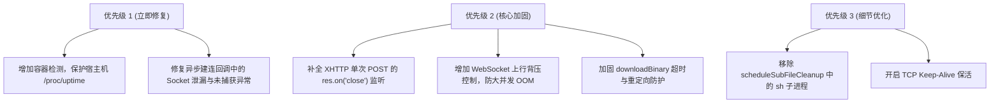

# Argo 项目深度代码审查与修复方案报告

> **审查日期**：2026-11-04  
> **审查对象**：`argo` 纯原生穿透代理系统（主分支 `main`）  
> **核心覆盖文件**：  
> - [`nodejs/index.js`](./nodejs/index.js) (Node.js 核心服务端实现)  
> - [`python/app.py`](./python/app.py) (Python 异步并发服务端实现)  
> - [`argo.sh`](./argo.sh) (Linux VPS 交互管理脚本)  
> - [`Dockerfile`](./Dockerfile) (多架构容器构建配置)  

---

## 目录
1. [审查综述与架构评估](#1-审查综述与架构评估)
2. [严重与高危缺陷（Critical / High）](#2-严重与高危缺陷critical--high)
   - [2.1 宿主机 /proc/uptime 全局被劫持破坏](#21-宿主机-procuptime-全局被劫持破坏)
   - [2.2 异步建连竞态导致 TCP Socket 永久泄漏与异常崩溃](#22-异步建连竞态导致-tcp-socket-永久泄漏与异常崩溃)
   - [2.3 Python 后台任务弱引用回收与全双工过早切断](#23-python-后台任务弱引用回收与全双工过早切断)
3. [中度风险与性能/DoS 隐患（Medium）](#3-中度风险与性能dos-隐患medium)
   - [3.1 上行流控与背压（Backpressure）机制缺失](#31-上行流控与背压backpressure机制缺失)
   - [3.2 单次 POST XHTTP 缺少客户端断连感知与资源清理](#32-单次-post-xhttp-缺少客户端断连感知与资源清理)
   - [3.3 downloadBinary 跨协议重定向与死循环/挂死隐患](#33-downloadbinary-跨协议重定向与死循环挂死隐患)
4. [低度风险与工程优化建议（Low / Polish）](#4-低度风险与工程优化建议low--polish)
   - [4.1 scheduleSubFileCleanup 无需唤起 Shell 子进程](#41-schedulesubfilecleanup-无需唤起-shell-子进程)
   - [4.2 TCP Keep-Alive 与 Cloudflare 空闲防掉线](#42-tcp-keep-alive-与-cloudflare-空闲防掉线)
   - [4.3 Dockerfile 非 Root 容器环境兼容性](#43-dockerfile-非-root-容器环境兼容性)
5. [双语言实现与生态对齐评估](#5-双语言实现与生态对齐评估)
6. [修复实施计划与优先级建议](#6-修复实施计划与优先级建议)

---

## 1. 审查综述与架构评估

本项目是一个**设计高度精简且创新的轻量穿透代理系统**。其最大亮点在于**完全摆脱外部重型二进制代理内核**（如 Xray、sing-box），通过纯代码手写还原了 VLESS / Trojan 协议的二进制解包、WebSocket 全双工管道、以及应对 CDN 并发特性的 XHTTP 会话保序机制。

### 架构亮点
1. **纯原生协议栈解包**：二进制流解析边界判断严密，准确支持 IPv4、域名、IPv6 及端口提取；
2. **防时序侧信道攻击**：UUID 与 Trojan 密码比对均采用恒定时间算法（`crypto.timingSafeEqual` 与 `hmac.compare_digest`）；
3. **全覆盖式 SSRF 出站安全防护**：完整覆盖私网保留网段、链路本地地址、云厂商元数据（169.254/100.100）、CGNAT、IPv4-mapped IPv6，且支持 `ALLOW_LAN` 环境变量动态放行；
4. **XHTTP 乱序重组与抗 DoS 设计**：按 `seq` 严格保序重组，对未认证会话设置了全局 16MB 与单会话 256KB 的内存熔断保护。

### 缺陷风险汇总表
| 编号 | 缺陷名称 | 影响文件 | 风险等级 | 核心影响 |
| :---: | :--- | :--- | :---: | :--- |
| **2.1** | 宿主机 `/proc/uptime` 全局被伪造劫持 | `nodejs/index.js`<br>`python/app.py` | 🔴 **严重** | 破坏 VPS 宿主机监控、计时与系统服务 |
| **2.2** | 异步建连竞态导致 Socket 泄漏与未捕获崩溃 | `nodejs/index.js` | 🟠 **高危** | 内存与文件句柄泄漏、Node.js 异常退出 |
| **2.3** | Python Task 弱引用 GC 与流通道过早切断 | `python/app.py` | 🟠 **高危** | 代理连接神秘断流、双向通信提前终止 |
| **3.1** | 上行（Client->Remote）背压控制缺失 | `nodejs/index.js`<br>`python/app.py` | 🟡 **中危** | 高速上传时 Node/Python 内存暴涨 OOM |
| **3.2** | 单次 POST XHTTP 缺少客户端断连销毁 | `nodejs/index.js` | 🟡 **中危** | 客户端取消请求后后端远端连接持续悬挂 |
| **3.3** | 原生下载工具缺少重定向/协议切换保护 | `nodejs/index.js` | 🟡 **中危** | 依赖下载抛错或主线程启动无超时死锁 |
| **4.1** | 临时文件自洁注入风险与冗余子进程 | `nodejs/index.js` | 🟢 **低危** | Shell 符号解析隐患、多余进程开销 |
| **4.2** | 远端 Socket 缺少 TCP Keep-Alive 保活 | `nodejs/index.js` | 🟢 **低危** | Cloudflare 100s 空闲超时容易断开长连接 |
| **4.3** | Docker 预置核心存放于 `/root` 目录 | `Dockerfile` | 🟢 **低危** | 非 root 容器或 PaaS 运行时可能无权限执行 |

---

## 2. 严重与高危缺陷（Critical / High）

### 2.1 宿主机 /proc/uptime 全局被劫持破坏

#### 缺陷定位
- `nodejs/index.js`（约第 199–215 行）：`setupContainerUptime()`
- `python/app.py`（约第 210–225 行）：`setup_container_uptime()`

#### 根因剖析
为了解决 PaaS / 容器环境中 Komari 监控探针将宿主机运行几百天的时间误认作容器运行时间的问题，代码使用了 Linux bind mount 技术挂载虚拟的 `/tmp/.fake_uptime` 到 `/proc/uptime`。

然而，函数内部仅检查了操作系统是否为 Linux（`os.platform() !== 'linux'`），**完全没有判断当前进程是运行在容器内还是在裸机 VPS 上**！
```javascript
// 现有危险逻辑 (nodejs/index.js)
function setupContainerUptime() {
  if (os.platform() !== 'linux' || uptimeTimer) return;
  const fakeFile = '/tmp/.fake_uptime';
  ...
  execSync(`mount --bind ${fakeFile} /proc/uptime`, { stdio: 'ignore' });
  ...
}
```
当用户在真实 Linux VPS 宿主机上通过 `argo.sh` 脚本以 `root` 权限安装并配置 Komari 探针启动服务时，此命令将**直接篡改整个宿主操作系统的开机时长**！
这会导致整台 VPS 的 `uptime` 命令、系统监控 Agent、fail2ban 封禁计时、Systemd 任务调度以及日志时间线彻底混乱；若程序异常崩溃未执行 `umount`，系统开机时长将永久停滞。

#### 修复方案
在执行挂载前，严格检查容器环境标志（Docker、Containerd、Podman、LXC 等特征文件）。若处于裸机/普通虚拟机环境，直接跳过此操作。

```javascript
// 推荐修复实现 (Node.js)
function isContainerEnvironment() {
  if (os.platform() !== 'linux') return false;
  try {
    if (fs.existsSync('/.dockerenv') || fs.existsSync('/run/.containerenv')) return true;
    const cgroup = fs.readFileSync('/proc/1/cgroup', 'utf8');
    return /docker|kubepods|containerd|lxc/i.test(cgroup);
  } catch {
    return false;
  }
}

function setupContainerUptime() {
  // 必须仅在容器内运行，严防篡改真实宿主机系统
  if (!isContainerEnvironment() || uptimeTimer) return;
  const fakeFile = '/tmp/.fake_uptime';
  const startTime = Math.floor(Date.now() / 1000);
  try {
    fs.writeFileSync(fakeFile, '0.00 0.00\n');
    execSync(`mount --bind ${fakeFile} /proc/uptime`, { stdio: 'ignore' });
    uptimeTimer = setInterval(() => {
      const elapsed = Math.floor(Date.now() / 1000) - startTime;
      try {
        fs.writeFileSync(fakeFile + '.tmp', `${elapsed}.00 ${elapsed}.00\n`);
        fs.renameSync(fakeFile + '.tmp', fakeFile);
      } catch {}
    }, 2000);
    uptimeTimer.unref();
  } catch {}
}
```

---

### 2.2 异步建连竞态导致 TCP Socket 永久泄漏与异常崩溃

#### 缺陷定位
- `nodejs/index.js`（约第 549–587 行）：`dispatchUplinkData` 内部的 `resolveAndConnect`
- `nodejs/index.js`（约第 1009–1026 行）：`wssVless.on('connection')`
- `nodejs/index.js`（约第 1069–1086 行）：`wssTrojan.on('connection')`

#### 根因剖析
`resolveAndConnect` 是一个耗时的异步网络操作（包含 DNS 解析与 TCP 三次握手，设置了 10 秒超时门禁）。在建连成功触发回调之前，存在多种客户端提前断开的竞态场景：

##### 场景 A：XHTTP 会话已被销毁，远端 Socket 成为孤儿泄漏
在 XHTTP 多路复用场景下，如果客户端在发起握手后立即断开（例如 GET downlink 关闭），`cleanupXhttpSession(sessionId)` 会执行并将会话从 `xhttpSessions` Map 中删除。但由于此时 `session.remoteSocket` 仍为 `null`，远端 Socket 无法在此处被关闭。
数秒后，远端 TCP 握手完成并触发 `onConnected(remoteSocket)`：
```javascript
resolveAndConnect(parsed.targetHost, parsed.targetPort, (remoteSocket) => {
  // 此时 session 已经被 cleanupXhttpSession 删除！
  session.isConnected = true;
  session.remoteSocket = remoteSocket; // remoteSocket 挂载在一个游离的失效对象上
  ...
  remoteSocket.on('close', () => cleanupXhttpSession(session.id)); // 试图清理一个已经不存在的 session
});
```
由于没有校验 `xhttpSessions.has(session.id)`，这个连接再也不会被定时器或外部请求跟踪，**将作为孤立死连接永久霸占系统 Socket 句柄**！

##### 场景 B：WebSocket 销毁时缺少错误监听引发崩溃
在 `resolveAndConnect` 内部，连接一旦成功，立即卸载了临时的 `initialErrorHandler`：
```javascript
socket.once('connect', () => {
  clearTimeout(connTimer);
  socket.removeListener('error', initialErrorHandler); // 错误监听被移除
  if (onConnected) onConnected(socket);
});
```
随后进入调用方的 `onConnected`：
```javascript
const sock = resolveAndConnect(parsed.targetHost, parsed.targetPort, (connectedSock) => {
  if (isWsClosed || ws.readyState !== WebSocket.OPEN) {
    connectedSock.destroy(); // 【隐患点】
    return;
  }
  ...
  setupDuplexPipe(ws, connectedSock); // 正式的 error 监听器在这里才挂载！
});
```
若 `isWsClosed` 为真，代码直接调用了 `connectedSock.destroy()`，此时 `connectedSock` 上**没有任何 `error` 事件监听器**！如果 destroy 操作触发了底层 TCP RST 错误事件，Node.js 将直接抛出 `Unhandled 'error' event`，导致整个代理服务进程异常崩溃。

#### 修复方案
1. 在 XHTTP 回调入口处，增加 `if (!xhttpSessions.has(session.id))` 判定，若已废弃则立即 `remoteSocket.destroy()`；
2. 在提前 destroy Socket 时，务必挂载空错误监听器或保证错误事件被捕获：

```javascript
// 修复 1：XHTTP dispatchUplinkData (nodejs/index.js)
resolveAndConnect(parsed.targetHost, parsed.targetPort, (remoteSocket) => {
  // 增加会话存活门禁：若会话在此期间已被销毁，立即关闭远端连接释放句柄
  if (!xhttpSessions.has(session.id)) {
    remoteSocket.destroy();
    return;
  }
  session.isConnected = true;
  ...
});

// 修复 2：WebSocket 提早断开时的安全清理 (nodejs/index.js)
if (isWsClosed || ws.readyState !== WebSocket.OPEN) {
  connectedSock.on('error', () => {}); // 挂载安全防崩监听
  connectedSock.destroy();
  return;
}
```

---

### 2.3 Python 后台任务弱引用回收与全双工过早切断

#### 缺陷定位
- `python/app.py`（约第 1265–1278 行）：`pipe_remote_to_ws`
- `python/app.py`（约第 1154–1182 行）：`pipe_req_to_remote`

#### 根因剖析
1. **协程弱引用 GC 丢包**：
   在 `handle_vless_ws` 和 `handle_trojan_ws` 中，代码直接使用了：
   ```python
   asyncio.create_task(pipe_remote_to_ws())
   ```
   Python 官方文档明确指出：`asyncio.create_task` 在事件循环中仅保留弱引用。如果不将返回的 Task 对象保存在外部集合中，在垃圾回收发生时，该任务随时可能被提前销毁，引发代理连接无故断开或控制台警告 `Task was destroyed but it is pending!`。
2. **单次 POST 模式下将半双工误当作全双工终止**：
   在 `handle_vless_xhttp` 单次请求转发逻辑中：
   ```python
   async def pipe_req_to_remote():
       try:
           while True:
               chunk = await content.readany()
               if not chunk:
                   break
               r_writer.write(chunk)
               await r_writer.drain()
       finally:
           r_writer.close() # 【隐患】客户端上行发完，直接把整个 TCP 连接彻底关闭！
           await r_writer.wait_closed()
   ```
   在客户端发送完请求体（如一个普通 HTTP POST 上传）后，`content.readany()` 读到 EOF。但此时**远端目标服务器通常才刚准备下发响应数据**！此处执行 `r_writer.close()` 会将底层的双向 Transport 直接关闭，导致下行流 `pipe_remote_to_resp` 发生读中断或抛出异常。

#### 修复方案
1. 建立 `background_tasks = set()` 强引用集合并在任务完成时剔除；
2. 单次 POST 模式下，上行传输完毕后不要直接 close 整个 writer，或使用 `asyncio.wait(..., return_when=asyncio.FIRST_COMPLETED)` 等待任一方向发生异常或正常结束。

```python
# 修复示例 (python/app.py)
# 1. 保存后台任务引用
background_tasks = set()

task = asyncio.create_task(pipe_remote_to_ws())
background_tasks.add(task)
task.add_done_callback(background_tasks.discard)

# 2. 正确等待双向管道
done, pending = await asyncio.wait(
    [asyncio.create_task(pipe_req_to_remote()), asyncio.create_task(pipe_remote_to_resp())],
    return_when=asyncio.FIRST_COMPLETED
)
for p in pending:
    p.cancel()
```

---

## 3. 中度风险与性能/DoS 隐患（Medium）

### 3.1 上行流控与背压（Backpressure）机制缺失

#### 缺陷定位
- `nodejs/index.js`（约第 1030 行、1089 行）
- `python/app.py`（约第 866 行）

#### 根因剖析
在下行（Remote -> Client）方向上，Node.js 实现了非常优秀的背压逻辑：当 `ws.bufferedAmount > 1MB` 时暂停远端 Socket（`remoteSocket.pause()`），下降低于 256KB 后恢复。

但在**上行（Client -> Remote）方向**：
```javascript
// nodejs/index.js
ws.on('message', (chunk) => {
  ...
  if (remoteSocket && !remoteSocket.destroyed && !remoteSocket.connecting) {
    remoteSocket.write(buffer); // 【隐患】返回值未检查，无背压控制
  }
});
```
Node.js 中，当写入速度大于网络外发能力时，`socket.write()` 会返回 `false`，多余的数据将被缓存在 Node.js 的 V8 内存堆中。代码中既没有检查返回值，也没有对 WebSocket 施加暂停流控。一旦客户端进行大文件测速或恶意发送超高并发数据，内存占用将极速上升导致 OOM。

在 Python 实现中，`sess['downlink_queue'] = asyncio.Queue()` 没有设置容量上限（`maxsize=0`），若远端传输极快而客户端读取延迟高，下行队列同样会无限缓存数据。

#### 修复方案
- Node.js 引入上行流控：当 `remoteSocket.write(buffer) === false` 时，暂停 WebSocket 底层传输；在 `remoteSocket.on('drain')` 时恢复接收；
- Python 设置队列上限：`asyncio.Queue(maxsize=128)`，使 `await queue.put()` 产生自然的协程挂起背压。

---

### 3.2 单次 POST XHTTP 缺少客户端断连感知与资源清理

#### 缺陷定位
- `nodejs/index.js`（约第 772–808 行及第 877–913 行）

#### 根因剖析
在单次 POST 请求处理中，代码仅在连接正常建连后监听了 `connectedSock.on('close')` 与 `error`：
```javascript
connectedSock.on('close', () => res.end());
connectedSock.on('error', () => res.end());
```
**遗漏关键事件**：完全没有监听客户端的 `res.on('close')`！
如果客户端在下载大文件或代理通信中途强制断开（如关闭代理、网络切换、浏览器终止页面），`res` 的 HTTP Socket 会立即触发 `close`。由于缺少监听，此时后端的 `connectedSock` 并不知道客户端已经走掉，仍会继续向不存在的连接写入或维持与远端服务器的空转，造成服务器带宽与连接句柄的浪费。

此外，若客户端在 `resolveAndConnect` 等待阶段提前断开，随后触发的 `res.writeHead(...)` 还会抛出 `ERR_HTTP_HEADERS_SENT` 或 `ERR_STREAM_DESTROYED`。

#### 修复方案
```javascript
// 在进入 resolveAndConnect 之后立即绑定客户端关闭事件
res.on('close', () => {
  if (remoteSocket && !remoteSocket.destroyed) {
    remoteSocket.destroy();
  }
});

// 在建连回调内先检查 res 是否已经不可写
const sock = resolveAndConnect(parsed.targetHost, parsed.targetPort, (connectedSock) => {
  if (res.destroyed || res.writableEnded) {
    connectedSock.destroy();
    return;
  }
  ...
});
```

---

### 3.3 downloadBinary 跨协议重定向与死循环/挂死隐患

#### 缺陷定位
- `nodejs/index.js`（约第 1279–1301 行）：`downloadBinary`

#### 根因剖析
Node.js 服务端在启动时若本地未发现 `cloudflared` 或 `komari-agent`，会调用 `downloadBinary` 从 GitHub Release 下载对应多架构核心。
现有的实现存在以下问题：
1. **无超时控制**：`https.get` 没有设置 `timeout`，在网络较差或 DNS 异常时，主进程将无限期挂起；
2. **跨协议抛错**：如果上游重定向到 `http://` 地址，继续直接调用 `https.get(currUrl)` 会抛出 Node 协议不匹配异常；
3. **无限重定向死循环**：递归调用 `handleReq(res.headers.location)` 未计算重定向跳数计数器（redirect limit）。

#### 修复方案
增加超时时间（如 15 秒门禁）、重定向跳数限制（最大 5 跳），并基于 URL 协议动态选择 `http` 或 `https` 模块：

```javascript
function downloadBinary(url, dest, maxRedirects = 5, timeoutMs = 15000) {
  return new Promise((resolve, reject) => {
    let timer = null;
    const handleReq = (currUrl, redirectsLeft) => {
      if (redirectsLeft < 0) return reject(new Error('Too many redirects'));
      const parsedUrl = new URL(currUrl);
      const client = parsedUrl.protocol === 'http:' ? http : https;
      
      const req = client.get(currUrl, (res) => {
        if (res.statusCode >= 300 && res.statusCode < 400 && res.headers.location) {
          const nextUrl = new URL(res.headers.location, currUrl).href;
          return handleReq(nextUrl, redirectsLeft - 1);
        }
        if (res.statusCode !== 200) {
          return reject(new Error(`HTTP ${res.statusCode}`));
        }
        const fileStream = fs.createWriteStream(dest);
        res.pipe(fileStream);
        fileStream.on('finish', () => {
          fileStream.close(() => {
            clearTimeout(timer);
            try { fs.chmodSync(dest, 0o755); } catch {}
            resolve(dest);
          });
        });
      });
      req.on('error', (err) => { clearTimeout(timer); reject(err); });
    };

    timer = setTimeout(() => reject(new Error(`Download timeout (${timeoutMs}ms)`)), timeoutMs);
    handleReq(url, maxRedirects);
  });
}
```

---

## 4. 低度风险与工程优化建议（Low / Polish）

### 4.1 scheduleSubFileCleanup 无需唤起 Shell 子进程
- **位置**：`nodejs/index.js` 第 1204 行
- **说明**：当前代码在 Linux 下执行 `spawn('sh', ['-c', `sleep ${delaySec} && rm -f ${JSON.stringify(SUB_FILE)}`])`。在 Node.js 环境中，直接使用 `setTimeout(() => { ... }, delaySec * 1000).unref()` 即可在后台完成清理，且不阻塞事件循环退出，完全没有必要拉起外部 `/bin/sh` 子进程，还能杜绝文件名包含特殊符号（如 `$`）时的变量解析问题。

### 4.2 TCP Keep-Alive 与 Cloudflare 空闲防掉线
- **位置**：`nodejs/index.js` 第 419 行（`resolveAndConnect` 内部）
- **说明**：Cloudflare 的 HTTP/WebSocket 边缘节点对空闲连接有大约 100 秒的超时限制。如果用户通过该代理连接 SSH 会话或空闲数据库，当没有通信流量时很容易被 Cloudflare 边缘端主动 RST。
- **优化**：在 `net.connect` 建立连接后，对出站 Socket 设置 `socket.setKeepAlive(true, 15000)`，开启系统级 TCP 心跳保活。

### 4.3 Dockerfile 非 Root 容器环境兼容性
- **位置**：`Dockerfile` 第 12–29 行
- **说明**：当前 Dockerfile 将预置的二进制核心存放在 `/root/.argo-core/` 下。如果将此镜像运行在要求以非 root 用户（例如 UID 10001）运行的容器云平台（如 OpenShift、Hugging Face Spaces、K8s 严格安全策略），非 root 用户通常无权读取 `/root` 目录。
- **优化**：建议统一放置在 `/usr/local/bin` 或 `/opt/argo-core` 并赋予 `755` 权限，增加不同容器云环境的兼容性。

---

## 5. 双语言实现与生态对齐评估

当前代码库中同时维护了 `nodejs/` 与 `python/` 两个版本的服务端。通过对比分析，两者现状如下：

1. **功能逻辑一致性**：
   - 协议解析算法（VLESS / Trojan Header）、常量时间比对、XHTTP 乱序序号重组等核心逻辑保持高度一致；
   - 均具备完备的 SSRF 私网阻断与 `ALLOW_LAN` 支持。
2. **运维生态差异（重要）**：
   - **`argo.sh` 管理脚本仅支持 Node.js**：脚本内所有的自动安装依赖、环境变量配置、Systemd 服务模版均硬编码为运行 `node index.js`；
   - **`Dockerfile` 仅打包 Node.js**：根目录下的 Dockerfile 基于 `node:22-alpine` 构建，且 `.dockerignore` 显式排除了 `python/` 目录；
   - **Python 版本定位**：当前 `python/` 更接近于纯粹的代码参考或特定独立 Python 环境下的替代方案。若未来需要长期双轨支持，建议在 `argo.sh` 中增加运行时选择开关（Node.js / Python 模式），或在文档中清晰标明主推运行环境。

---

## 6. 修复实施计划与优先级建议



### 第一阶段（阻断严重隐患）：
1. 在 `nodejs/index.js` 和 `python/app.py` 中引入 `isContainerEnvironment()` 校验，非容器环境坚决禁止 `mount --bind /proc/uptime`；
2. 在 `dispatchUplinkData` 的建连回调中加入 `if (!xhttpSessions.has(session.id)) { remoteSocket.destroy(); return; }`，在 WebSocket 断开清理处挂载安全错误监听。

### 第二阶段（稳定性与流控优化）：
1. 完善 XHTTP 单请求的客户端连接状态感知，在 `res.on('close')` 时销毁后端 Socket；
2. 完善上行背压控制，重写 `downloadBinary` 引入超时与协议适配。

### 第三阶段（代码美化与生态规范）：
1. 使用原生 `setTimeout` 简化文件自洁逻辑；
2. 出站 Socket 开启 `socket.setKeepAlive(true, 15000)`。
