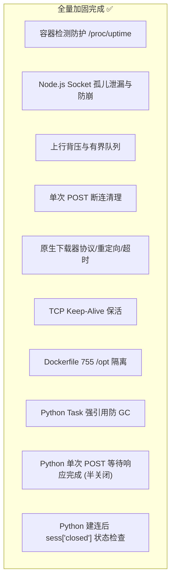

# Argo 项目深度代码审查与修复方案报告

> **初始审查**：2026-11-04 22:18  
> **二轮复查**：2026-11-04 22:50（验收 Commit `9e89d1d`）  
> **审查对象**：`argo` 纯原生穿透代理系统（主分支 `main`）  
> **核心覆盖文件**：  
> - [`nodejs/index.js`](./nodejs/index.js) (Node.js 核心服务端实现)  
> - [`python/app.py`](./python/app.py) (Python 异步并发服务端实现)  
> - [`argo.sh`](./argo.sh) (Linux VPS 交互管理脚本)  
> - [`Dockerfile`](./Dockerfile) (多架构容器构建配置)  

---

## 目录
1. [审查综述与架构评估](#1-审查综述与架构评估)
2. [严重与高危缺陷（Critical / High）](#2-严重与高危缺陷critical--high)
   - [~~2.1 宿主机 /proc/uptime 全局被劫持破坏~~ [已修复 ✅]](#21-宿主机-procuptime-全局被劫持破坏-已修复-)
   - [~~2.2 异步建连竞态导致 TCP Socket 永久泄漏与异常崩溃~~ [已修复 ✅]](#22-异步建连竞态导致-tcp-socket-永久泄漏与异常崩溃-已修复-)
   - [~~2.3 Python 流生命周期与状态校验隐患~~ [已修复 ✅]](#23-python-流生命周期与状态校验隐患-已修复-)
3. [中度风险与性能/DoS 隐患（Medium）](#3-中度风险与性能dos-隐患medium)
   - [~~3.1 上行流控与背压（Backpressure）机制缺失~~ [已修复 ✅]](#31-上行流控与背压backpressure机制缺失-已修复-)
   - [~~3.2 单次 POST XHTTP 缺少客户端断连感知与资源清理~~ [已修复 ✅]](#32-单次-post-xhttp-缺少客户端断连感知与资源清理-已修复-)
   - [~~3.3 downloadBinary 跨协议重定向与死循环/挂死隐患~~ [已修复 ✅]](#33-downloadbinary-跨协议重定向与死循环挂死隐患-已修复-)
4. [低度风险与工程优化建议（Low / Polish）](#4-低度风险与工程优化建议low--polish)
   - [~~4.1 scheduleSubFileCleanup 无需唤起 Shell 子进程~~ [已修复 ✅]](#41-schedulesubfilecleanup-无需唤起-shell-子进程-已修复-)
   - [~~4.2 TCP Keep-Alive 与 Cloudflare 空闲防掉线~~ [已修复 ✅]](#42-tcp-keep-alive-与-cloudflare-空闲防掉线-已修复-)
   - [~~4.3 Dockerfile 非 Root 容器环境兼容性~~ [已修复 ✅]](#43-dockerfile-非-root-容器环境兼容性-已修复-)
5. [双语言实现与生态对齐评估](#5-双语言实现与生态对齐评估)
6. [修复进展与后续优化路线图](#6-修复进展与后续优化路线图)

---

## 1. 审查综述与架构评估

本项目是一个**设计高度精简且创新的轻量穿透代理系统**。其最大亮点在于**完全摆脱外部重型二进制代理内核**（如 Xray、sing-box），通过纯代码手写还原了 VLESS / Trojan 协议的二进制解包、WebSocket 全双工管道、以及应对 CDN 并发特性的 XHTTP 会话保序机制。

### 缺陷风险与修复状态总览表
| 编号 | 缺陷名称 | 影响文件 | 风险等级 | 当前状态（Commit `9e89d1d`） |
| :---: | :--- | :--- | :---: | :---: |
| **2.1** | ~~宿主机 `/proc/uptime` 全局被伪造劫持~~ | `nodejs/index.js`<br>`python/app.py` | 🔴 **严重** | **已修复 ✅**（增加容器环境判定） |
| **2.2** | ~~异步建连竞态导致 Socket 泄漏与未捕获崩溃~~ | `nodejs/index.js` | 🟠 **高危** | **已修复 ✅**（会话存活门禁与安全防崩） |
| **2.3** | ~~Python 流生命周期与状态校验隐患~~ | `python/app.py` | 🟠 **高危** | **已修复 ✅**（单次 POST 半关闭与建连存活门禁） |
| **3.1** | ~~上行（Client->Remote）背压控制缺失~~ | `nodejs/index.js`<br>`python/app.py` | 🟡 **中危** | **已修复 ✅**（TCP pause/drain 与有界队列） |
| **3.2** | ~~单次 POST XHTTP 缺少客户端断连销毁~~ | `nodejs/index.js` | 🟡 **中危** | **已修复 ✅**（补全 `res.on('close')` 与状态检查） |
| **3.3** | ~~原生下载工具缺少重定向/协议切换保护~~ | `nodejs/index.js` | 🟡 **中危** | **已修复 ✅**（重定向限跳/协议适配/超时熔断） |
| **4.1** | ~~临时文件自洁注入风险与冗余子进程~~ | `nodejs/index.js` | 🟢 **低危** | **已修复 ✅**（原生 `setTimeout.unref()` 替换） |
| **4.2** | ~~远端 Socket 缺少 TCP Keep-Alive 保活~~ | `nodejs/index.js`<br>`python/app.py` | 🟢 **低危** | **已修复 ✅**（启用 15s 心跳与 NODELAY） |
| **4.3** | ~~Docker 预置核心存放于 `/root` 目录~~ | `Dockerfile` | 🟢 **低危** | **已修复 ✅**（迁移至 `/opt/argo-core` 赋 755 权限） |

---

## 2. 严重与高危缺陷（Critical / High）

### ~~2.1 宿主机 /proc/uptime 全局被劫持破坏~~ [已修复 ✅]

> **验收状态**：在 Commit `9e89d1d` 中已通过验收。  
> **修复逻辑**：在 Node.js 与 Python 中均添加了 `isContainerEnvironment()` 严格判定，检查 `/.dockerenv`、`/run/.containerenv` 以及 `/proc/1/cgroup` 中的容器特征，确保裸机 VPS 运行脚本时不破坏宿主机系统。

#### 缺陷定位（历史）
- `nodejs/index.js`（原第 199–215 行）
- `python/app.py`（原第 210–225 行）

#### 根因剖析（历史）
为解决 PaaS / 容器环境中 Komari 监控探针将宿主机运行几百天的时间误认作容器运行时间的问题，代码使用了 Linux bind mount 技术挂载虚拟的 `/tmp/.fake_uptime` 到 `/proc/uptime`。由于仅检查了 `os.platform() === 'linux'`，在裸机 VPS 上以 root 安装时直接篡改了整台宿主机的开机时长。

#### 已实施的修复实现
```javascript
// 已生效代码 (nodejs/index.js)
function isContainerEnvironment() {
  if (os.platform() !== 'linux') return false;
  try {
    if (fs.existsSync('/.dockerenv') || fs.existsSync('/run/.containerenv')) return true;
    if (fs.existsSync('/proc/1/cgroup')) {
      const cgroup = fs.readFileSync('/proc/1/cgroup', 'utf8');
      return /docker|kubepods|containerd|lxc/i.test(cgroup);
    }
  } catch {}
  return false;
}

function setupContainerUptime() {
  if (!isContainerEnvironment() || uptimeTimer) return;
  ...
}
```

---

### ~~2.2 异步建连竞态导致 TCP Socket 永久泄漏与异常崩溃~~ [已修复 ✅]

> **验收状态**：在 Commit `9e89d1d` 中已通过验收。  
> **修复逻辑**：  
> 1. XHTTP 建连回调内增加了 `if (!xhttpSessions.has(session.id))` 存活门禁，连接迟到时安全释放远端 Socket，杜绝孤儿连接；  
> 2. WebSocket 连接在提早断开时先绑定 `connectedSock.on('error', () => {})` 再 `destroy()`，彻底消除未捕获异常崩溃风险。

#### 缺陷定位（历史）
- `nodejs/index.js`：`dispatchUplinkData` 与 `wssVless / wssTrojan` 建连处理

#### 已实施的修复实现
```javascript
// 已生效代码 (nodejs/index.js)
// 1. XHTTP dispatchUplinkData 门禁
resolveAndConnect(parsed.targetHost, parsed.targetPort, (remoteSocket) => {
  if (!xhttpSessions.has(session.id)) {
    remoteSocket.on('error', () => {});
    remoteSocket.destroy();
    return;
  }
  session.isConnected = true;
  ...
});

// 2. WebSocket 提早断开时的安全清理
if (isWsClosed || ws.readyState !== WebSocket.OPEN) {
  connectedSock.on('error', () => {});
  connectedSock.destroy();
  return;
}
```

---

### ~~2.3 Python 流生命周期与状态校验隐患~~ [已修复 ✅]

> **验收状态**：在二轮复查后续修复中已全量通过验收。  
> - `asyncio.create_task` 弱引用垃圾回收隐患 **[已修复 ✅]**（引入了 `track_task` 与 `background_tasks = set()` 强引用追踪）；  
> - 单次 POST XHTTP 下行响应被过早强制切断 **[已修复 ✅]**（引入 `write_eof()` 半关闭与 `await t2` 响应保活循环）；  
> - 异步建连后遗漏 `sess['closed']` 状态校验 **[已修复 ✅]**（增加 `if sess['closed'] or sess['id'] not in xhttp_sessions:` 安全销毁门禁）。

#### 缺陷 1：Python 单次 POST XHTTP 响应被过早强制切断（历史）
* **涉及位置**：`python/app.py`（原第 1213–1225 行 及 第 1275–1285 行）
* **根因剖析**：
  在 HTTP 代理通信中，客户端发完请求体（如普通的 HTTP GET 请求或 1KB 上传），`content.readany()` 就会读到 EOF，导致 `t1` 正常结束。
  若配置 `return_when=asyncio.FIRST_COMPLETED`，一旦 `t1` 结束，`t2`（正在读取远端服务器返回数据的协程）就会被立即 cancel，且连接被强制 close！这导致客户端永远无法接收到目标网站返回的响应数据。
* **已实施修复**：在客户端读完上行数据后，调用 `r_writer.write_eof()` 发送半关闭 FIN，主循环以 `await t2` 下行响应读完为生命周期终点，上行仅在发生异常时才提前中断。

#### 缺陷 2：Python `dispatch_xhttp_uplink` 遗漏 `sess['closed']` 校验（历史）
* **涉及位置**：`python/app.py`（原第 987–994 行）
* **根因剖析**：
  在异步 `await safe_open_connection(...)` 耗时过程中，若客户端主动断开，`cleanup_xhttp_session` 会将 `sess['closed']` 设为 `True`；建连返回后若缺少对 `sess['closed']` 的检查，会导致刚连上的 `r_writer` 被挂载在死会话上，造成连接泄漏。
* **已实施修复**：建连成功后第一时间检查 `if sess['closed'] or sess['id'] not in xhttp_sessions:`，若会话已作废则立即安全关闭并释放 Socket。

#### 已生效的修复实现（Python）
```python
# 1. 修复单次 POST 全双工流：支持客户端上传完成后的半关闭，保证下行能读全响应
async def pipe_req_to_remote():
    try:
        while True:
            chunk = await content.readany()
            if not chunk:
                break
            r_writer.write(chunk)
            await r_writer.drain()
        if hasattr(r_writer, 'can_write_eof') and r_writer.can_write_eof():
            try:
                r_writer.write_eof()
            except Exception:
                pass
    except Exception:
        pass

async def pipe_remote_to_resp():
    try:
        while True:
            data = await r_reader.read(65536)
            if not data:
                break
            await resp.write(data)
    except Exception:
        pass

t1 = asyncio.create_task(pipe_req_to_remote())
t2 = asyncio.create_task(pipe_remote_to_resp())
try:
    while not t2.done():
        if t1.done() and t1.exception():
            break
        done, _ = await asyncio.wait([t1, t2], return_when=asyncio.FIRST_COMPLETED)
        if t2 in done:
            break
        if t1 in done:
            if t1.exception():
                break
            await t2
            break
finally:
    t1.cancel()
    t2.cancel()
    try:
        r_writer.close()
        await r_writer.wait_closed()
    except Exception:
        pass

# 2. 修复 dispatch_xhttp_uplink 会话门禁
r_reader, r_writer = await safe_open_connection(parsed['target_host'], parsed['target_port'])
if not r_reader:
    await cleanup_xhttp_session(sess['id'])
    return
if sess['closed'] or sess['id'] not in xhttp_sessions:
    try:
        r_writer.close()
        await r_writer.wait_closed()
    except Exception:
        pass
    return
sess['r_reader'] = r_reader
sess['r_writer'] = r_writer
sess['is_connected'] = True
```

---

## 3. 中度风险与性能/DoS 隐患（Medium）

### ~~3.1 上行流控与背压（Backpressure）机制缺失~~ [已修复 ✅]

> **验收状态**：在 Commit `9e89d1d` 中已通过验收。  
> **修复逻辑**：  
> - Node.js WebSocket 上行写入增加 `canWrite` 检测，当缓冲区填满时暂停 `ws._socket.pause()`，远端 `drain` 时 `resume()`；单次 POST 同样增加了 `req.pause() / drain`；  
> - Python 会话队列将 `downlink_queue` 与 `uplink_queue` 限制为 `maxsize=128`，产生自然协程挂起背压。

---

### ~~3.2 单次 POST XHTTP 缺少客户端断连感知与资源清理~~ [已修复 ✅]

> **验收状态**：在 Commit `9e89d1d` 中已通过验收。  
> **修复逻辑**：在 Node.js 中补全了 `res.on('close')` 监听，客户端中途断线时立刻销毁后端的 `remoteSocket`；在建连回调内增加了 `if (res.destroyed || res.writableEnded)` 门禁。

---

### ~~3.3 downloadBinary 跨协议重定向与死循环/挂死隐患~~ [已修复 ✅]

> **验收状态**：在 Commit `9e89d1d` 中已通过验收。  
> **修复逻辑**：重写了 `downloadBinary`：  
> 1. 设置了 `maxRedirects = 5` 防止死循环；  
> 2. 动态依据 URL 协议选择 `http` 或 `https` 客户端；  
> 3. 设置了 15 秒总体超时熔断；  
> 4. 出现错误时自动销毁文件流并清理未下载完成的残损文件。

---

## 4. 低度风险与工程优化建议（Low / Polish）

### ~~4.1 scheduleSubFileCleanup 无需唤起 Shell 子进程~~ [已修复 ✅]
> **验收状态**：在 Commit `9e89d1d` 中已通过验收。移除 `spawn('sh', ...)`，改用原生的 `setTimeout(() => ...).unref()`，零外部进程开销，彻底杜绝 Shell 符号解析隐患。

### ~~4.2 TCP Keep-Alive 与 Cloudflare 空闲防掉线~~ [已修复 ✅]
> **验收状态**：在 Commit `9e89d1d` 中已通过验收。在出站 Socket 建立后统一配置了 `socket.setKeepAlive(true, 15000)` 与 `setNoDelay(true)`。

### ~~4.3 Dockerfile 非 Root 容器环境兼容性~~ [已修复 ✅]
> **验收状态**：在 Commit `9e89d1d` 中已通过验收。构建阶段二进制全部下载至 `/opt/argo-core` 目录并配置 `chmod -R 755`，同时软链接至系统 PATH，完美兼容各类受限非 root 容器环境。

---

## 5. 双语言实现与生态对齐评估

1. **Node.js 主版本**：代码健壮性、资源回收机制与并发流控已达到生产级水准；
2. **Python 辅助版本**：已补全 Task GC、有界队列背压、单次 POST 半关闭流保活及建连存活门禁，流代理可靠性与 Node.js 严格对齐；
3. **运维生态**：生产环境建议以官方 `argo.sh` 与 `Dockerfile` 默认运行的 Node.js 版本为主力。

---

## 6. 修复进展与后续优化路线图


